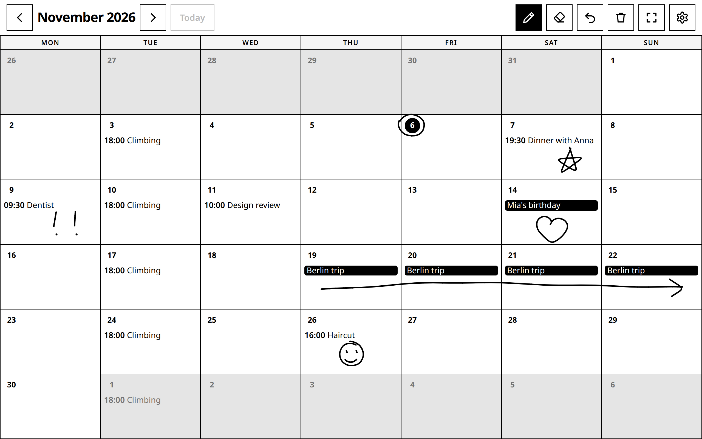

# Inky calendar

**What if a calendar had a drawing layer?**

Events come from any standard iCal link (Google Calendar, Apple, Nextcloud, …). On top of the month grid sits a transparent canvas you can write and doodle on: circle a date, underline a deadline, draw a heart on a birthday. The drawing is kept per month and stays put when the events change.

<p align="center">
  <video src="https://github.com/simon-lund/inky-calendar/raw/main/docs/inky-calendar-demo.mp4" controls muted loop playsinline width="320"></video>
</p>

<sub>A 30-second walkthrough ([direct link to the video](docs/inky-calendar-demo.mp4)). All events and drawings are made up.</sub>



## Made for e-ink with touch or pen input

The idea behind it is a wall or desk calendar on an **e-ink display with touch or pen input**: slow-changing, glanceable, and you write on it like a paper calendar. So the interface is built to suit that kind of screen:

- black on white with a few light greys, no colour, no gradients
- no animations or transitions, only state changes (an e-ink panel refreshes slowly)
- large, square touch targets, no hover states, no scrolling
- strokes are stored as vectors in 0–1 coordinates, so the same drawing renders on a panel of any size or orientation

It also works as a plain web page on any tablet or touchscreen, which is how it was built and tested. I have not run it on actual e-ink hardware yet, so expect to tune refresh behaviour there.

## What it does

- Draw with finger, pen or mouse. Pen, eraser, undo, clear month.
- Drawings are saved per month on the machine that hosts the page, so every screen shows the same calendar.
- Shows events from an iCal link: repeating events, excluded dates, all-day and multi-day events.
- Wall-calendar behaviour: marks today, rolls over at midnight, keeps the screen awake, returns to the current month after 5 minutes without a touch, fullscreen button.
- No accounts, no login. Anyone who can reach the page can draw on it, so keep it on your home network.

## Run it

Needs Node 22.13 or newer. Nothing native to compile: it uses Node's built-in SQLite.

```bash
pnpm install
pnpm build
pnpm start
```

Open `http://<this-machine>:3000` on the touchscreen (`PORT=8080 pnpm start` for another port). Drawings live in `calendar.db` next to the app; back that file up and you have backed up everything.

### Show your events

Tap the gear in the top right and paste an iCal link. In Google Calendar: Settings → your calendar → Integrate calendar → **Secret address in iCal format**. The link is remembered by that screen's browser. Leave it empty for a plain drawing calendar.

To set one feed for every screen, start the server with it (see `.env.example`):

```bash
INKY_ICAL_URL="https://calendar.google.com/…/basic.ics" pnpm start
```

Treat that link like a password.

### On a touchscreen

- **Chromium / Chrome kiosk** (Raspberry Pi, old laptop): `chromium --kiosk http://<host>:3000`
- **Tablet**: open the page, "Add to Home Screen", launch it from there for a full-screen app.
- **Start on boot**: run `pnpm start` as a systemd service or with any process manager.

## How it works

Next.js (App Router) and React. `src/lib/strokes.ts` defines the drawing format, `src/components/DrawingLayer.tsx` is the canvas (pointer events, so touch, pen and mouse behave the same), and the API routes in `src/app/api/` fetch the feed and store drawings in SQLite.

A month's drawing is one JSON document:

```json
{ "v": 2, "strokes": [{ "tool": "pen", "w": 0.0035, "pts": [[0.41, 0.27], [0.42, 0.28]] }] }
```

Coordinates are fractions of the canvas and the width is a fraction of its shorter side. Undo removes the last stroke; the eraser is a stroke that cuts through the ink beneath it.

## Static demo

`INKY_DEMO=1 pnpm build` makes a server-less copy in `out/`, with example events and drawings kept in the visitor's browser. Set `BASE_PATH=/some/path` if it is hosted in a sub-folder.

## License

MIT, see [LICENSE](LICENSE).
